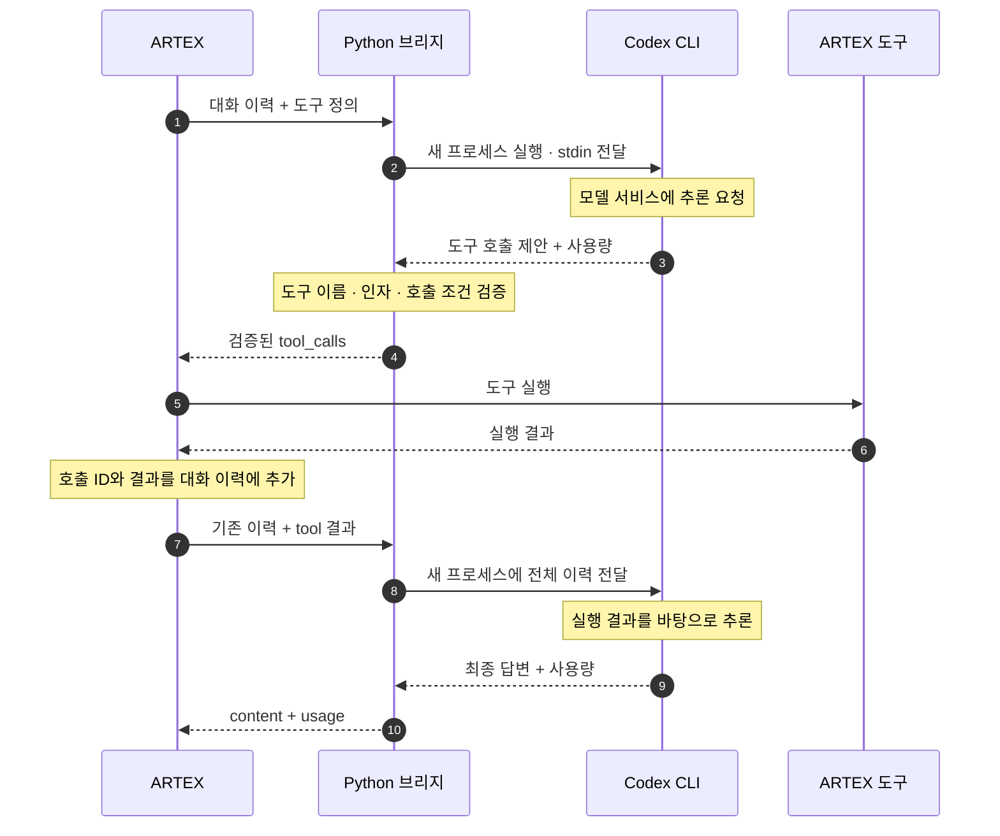

ARTEX로 원큐오더의 보안 테스트를 준비하면서 가장 먼저 고민한 것은 모델 연결 비용이었습니다. 이미 ChatGPT에 100달러 넘게 지불하고 있는데, 모델을 연결하려고 API 사용료까지 따로 내고 싶지는 않았습니다. [OpenAI 공식 과금 안내](https://learn.chatgpt.com/docs/pricing)에서도 구독 사용량과 API 키 기반 과금을 구분합니다.

그래서 **ChatGPT 계정으로 로그인된 Codex CLI를 ARTEX에서 호출하는 방식**을 택했습니다. 로컬 Ollama 모델 대신 이 구성을 고른 이유도 기존 구독을 먼저 활용하고 싶었기 때문입니다. 이 방식도 구독 사용 한도를 소모하므로, 무제한 호출이 아니라 이미 내는 비용의 범위 안에서 개인 실험을 하는 것이 목표입니다.

문제는 ARTEX에는 모델 API 주소를 입력하는 설정이 있지만, Codex CLI는 터미널 프로그램이라는 점입니다. 그래서 **ARTEX의 HTTP 요청을 받아 Codex CLI를 실행하고, 결과를 ARTEX가 이해하는 응답으로 돌려주는 Python 브리지**를 만들었습니다.

## 전체 구조



ARTEX와 브리지는 로컬 HTTP(`POST /v1/chat/completions`)로, 브리지와 CLI는 `stdin`과 결과 JSON 파일·표준 출력 JSONL로 통신합니다. 위 흐름은 도구를 한 번 실행하는 경우이며, 추가 조회가 필요하면 도구 호출과 결과 전달 구간이 반복됩니다.

### 왜 ARTEX 내부가 아니라 별도 브리지인가

ARTEX에는 모델 호출부터 도구 실행, 결과를 대화에 추가하는 흐름까지 이미 구현되어 있습니다. 이 흐름을 그대로 활용하기 위해, ARTEX 내부에 Codex 전용 코드를 추가하는 대신 기존 모델 요청을 브리지로 보내도록 했습니다. 브리지는 codex exec를 실행하고, 그 결과를 ARTEX가 처리할 수 있는 응답으로 변환합니다.

제공하는 인터페이스는 두 개입니다.

```text
GET  /v1/models
POST /v1/chat/completions
```

이 구성 덕분에 ARTEX 서버·DB·프런트엔드를 수정하지 않고 연결 방식을 추가할 수 있었습니다. 대신 요청마다 CLI를 시작하는 비용과 두 인터페이스를 맞추는 부담은 브리지가 맡습니다.

## 1. 대화와 도구 정의를 CLI 입력으로 변환

`prepare()`는 모델 별칭이 `codex-cli`인지 확인하고, 텍스트 메시지와 function 도구만 받도록 범위를 제한합니다. 마지막 질문만 전달하면 도구를 사용하는 작업이 이어지지 않으므로, 다음 필드를 함께 보존합니다.

```python
# bridge.py의 prepare() 발췌
envelope = {key: body[key] for key in (
    "messages", "tools", "tool_choice", "parallel_tool_calls"
) if key in body}
```

이 JSON 앞에는 "다음 assistant 응답을 만들고, 도구는 직접 실행하지 말고 호출 제안으로 반환하라"는 지시문을 붙입니다. 도구 결과를 더 높은 우선순위의 지시로 취급하지 말라는 내용도 포함했습니다. `assistant.tool_calls`와 `tool.tool_call_id`는 도구 결과와 호출을 잇는 식별자이므로 그대로 전달합니다.

대화 유지는 Codex의 최근 세션을 재개하는 방식이 아닙니다. **ARTEX가 이력을 관리하고, 브리지는 매 요청마다 전체 이력을 넣어 새 CLI 프로세스를 시작합니다.** 그래서 `resume --last`로 다른 작업의 세션과 섞일 일이 없습니다.

## 2. `codex exec`와는 프로세스로 통신

별도의 Codex HTTP 서버 없이, `subprocess.Popen()`으로 CLI를 실행하고 `stdin`에 프롬프트를 넣습니다. 실행 옵션의 핵심은 다음과 같습니다.

```bash
codex exec \
  --json \
  --ignore-user-config \
  --ephemeral \
  --skip-git-repo-check \
  --sandbox read-only \
  -c 'approval_policy="never"' \
  -c 'forced_login_method="chatgpt"' \
  -c 'features.shell_tool=false' \
  -c 'web_search="disabled"' \
  --output-schema schema.json \
  --output-last-message answer.json \
  -
```

마지막 `-`는 프롬프트를 `stdin`으로 받게 합니다. 사용자 입력을 셸 명령 문자열에 끼워 넣지 않고, 실행 인자와 입력 데이터를 분리했습니다.

```python
# CodexRunner.__call__()의 프로세스 통신 부분 발췌
with tempfile.TemporaryFile() as events, subprocess.Popen(
    args,
    stdin=subprocess.PIPE,
    stdout=events,
    stderr=subprocess.DEVNULL,
    cwd=root,
    env=env,
    start_new_session=(os.name == "posix"),
) as proc:
    proc.communicate(prompt.encode("utf-8"), timeout=self.timeout)
```

결과는 두 갈래로 받습니다.

- `--output-last-message`로 저장한 최종 메시지. `--output-schema`로 `content`와 `tool_calls` 구조를 지정해, 자연어에서 명령어를 정규식으로 찾지 않습니다.
- `--json`으로 표준 출력에 기록된 JSONL 이벤트. 여기서 토큰 사용량을 읽습니다.

임시 작업 디렉터리를 쓰고 개인 설정 로딩을 끈 것은, 기존 프로젝트의 지시문이나 개인 MCP 설정이 모델 연결에 섞이지 않게 하기 위해서입니다. 비대화형 실행과 JSONL 출력은 [Codex 공식 CLI 문서](https://learn.chatgpt.com/docs/developer-commands#codex-exec)에 설명되어 있습니다.

## 3. 도구 호출 한 바퀴

아래 JSON은 위 다이어그램의 흐름을 설명하기 위한 축약 예시이며, 실제 요청 로그가 아닙니다.

모델이 `lookup` 도구가 필요하다고 판단하면 CLI의 최종 결과는 다음과 같습니다. 이 시점에는 아무것도 실행되지 않았습니다.

```json
{
  "content": "",
  "tool_calls": [
    { "name": "lookup", "arguments": "{\"id\":7}" }
  ]
}
```

브리지의 `decode_answer()`가 이를 검사한 뒤 호출 ID를 생성해 ARTEX 형식으로 변환합니다.

```json
{
  "role": "assistant",
  "content": null,
  "tool_calls": [
    {
      "id": "call_example_01",
      "type": "function",
      "function": { "name": "lookup", "arguments": "{\"id\":7}" }
    }
  ]
}
```

ARTEX가 도구를 실행하면 다음 요청에는 이전 assistant 메시지와 함께 아래 메시지가 들어가고, 브리지는 이 이력을 다시 CLI로 전달합니다.

```json
{
  "role": "tool",
  "tool_call_id": "call_example_01",
  "content": "found"
}
```

### 도구 이름과 인자 검증

출력 스키마는 응답의 외형만 정해 줍니다. 그래서 `decode_answer()`에서 다음을 추가로 확인합니다.

- 등록된 도구 이름인지
- `arguments`가 JSON 객체이고 해당 도구의 JSON Schema를 만족하는지
- `tool_choice=none`인데 호출이 있거나, `required`인데 호출이 없는 경우
- 병렬 호출을 금지했는데 여러 호출이 온 경우

통과하지 못하면 `502`를 반환하고 ARTEX에는 전달하지 않습니다. 입력 스키마의 외부 참조도 막아, 검사 중 외부 URL을 가져오지 않게 했습니다.

다만 스키마 검증이 작업의 안전성을 판정하지는 않습니다. 대상 제한, 실행 권한, 승인 정책은 ARTEX와 테스트 환경에서 따로 관리해야 합니다. CLI의 `read-only` 옵션도 ARTEX가 실행하는 도구까지 읽기 전용으로 만들지는 않습니다.

## 4. 인증 분리

| 구간 | 인증 값 | 관리 주체 |
| --- | --- | --- |
| ARTEX → 로컬 브리지 | `ARTEX_CODEX_BRIDGE_TOKEN` (Bearer) | 브리지 운영자와 ARTEX 설정 |
| Codex CLI → 모델 서비스 | `codex login` | Codex CLI |

ARTEX의 API Key 칸에는 브리지 접속용 로컬 토큰을 넣습니다. OpenAI 계정 인증 정보를 복사하는 자리가 아닙니다. 브리지도 인증 파일에서 토큰을 읽거나 복사하지 않습니다.

- 자식 프로세스 환경에서 `OPENAI_API_KEY`, `CODEX_API_KEY`, `ARTEX_CODEX_BRIDGE_TOKEN`을 제거해 로컬 토큰이 API 키로 오인되는 것을 막았습니다.
- 서버는 `127.0.0.1`에만 바인딩하고, 토큰을 비교하며, `Origin` 헤더가 있는 요청은 거절합니다.
- 프롬프트·도구 결과·CLI 오류 원문은 HTTP 오류나 접속 로그에 출력하지 않습니다.

## 5. 토큰 사용량 전달

ARTEX에서 작업별 사용량을 볼 수 있도록 응답에 토큰 집계를 함께 담았습니다. 사용량의 출처는 모델의 답변이 아니라 CLI가 출력하는 `turn.completed.usage` 이벤트입니다. `read_usage()`가 값을 읽고 음수나 잘못된 자료형을 검사한 뒤 `usage` 필드로 변환합니다.

| CLI 이벤트 필드 | ARTEX에 반환하는 필드 |
| --- | --- |
| `input_tokens` | `usage.prompt_tokens` |
| `output_tokens` | `usage.completion_tokens` |
| 입력 + 출력 | `usage.total_tokens` |
| `cached_input_tokens` | `usage.prompt_tokens_details.cached_tokens` |
| `reasoning_output_tokens` | `usage.completion_tokens_details.reasoning_tokens` |

캐시 입력은 입력의, 추론 토큰은 출력의 일부이므로 상세 필드에만 담고 총합에는 다시 더하지 않습니다. 사용량 이벤트가 없으면 `0`으로 기록하지 않고 `usage`를 생략합니다. SSE 요청에서는 `include_usage=true`일 때 종료 직전에 사용량 이벤트를 보냅니다. 이 값은 호출 사용량 집계용이며, 구독의 잔여 한도나 청구 금액을 계산하지는 않습니다.

## 직접 연결하기

```bash
git fetch origin
git switch feat/codex-cli-bridge

codex login
codex login status
codex exec --help   # 위 실행 옵션 지원 여부 확인

python3 -m venv tools/codex_bridge/.venv
tools/codex_bridge/.venv/bin/python -m pip install \
  -r tools/codex_bridge/requirements.txt

export ARTEX_CODEX_BRIDGE_TOKEN="$(python3 -c 'import secrets; print(secrets.token_urlsafe(32))')"

tools/codex_bridge/.venv/bin/python \
  tools/codex_bridge/bridge.py --effort low
```

토큰은 따로 보관하고 ARTEX 설정에도 같은 값을 입력합니다. 새 터미널에서 다시 생성하면 다른 값이 되니 주의해야 합니다.

| 항목 | 설정 |
| --- | --- |
| Provider | `OpenAI` |
| Base URL | `http://127.0.0.1:8766/v1` |
| API Key | 브리지와 같은 로컬 토큰 |
| Model | `codex-cli` |
| 스트리밍 | 끔 |

`codex-cli`는 브리지가 받는 별칭입니다. 실제 모델을 지정하려면 서버 시작 옵션 `--model`에 계정에서 사용 가능한 모델 ID를 넣습니다. 연결은 아래 요청으로 확인하며, `choices[0].message.content`와 `usage`를 보면 됩니다.

```bash
curl --max-time 250 http://127.0.0.1:8766/v1/chat/completions \
  -H "Authorization: Bearer $ARTEX_CODEX_BRIDGE_TOKEN" \
  -H 'Content-Type: application/json' \
  -d '{
    "model": "codex-cli",
    "messages": [{"role": "user", "content": "Reply with OK."}],
    "stream": false
  }'
```

ARTEX와 브리지는 같은 호스트에서 실행해야 합니다. 브리지가 루프백에만 바인딩하므로 Docker 컨테이너에서는 접근할 수 없고, Windows에서는 WSL 안에 CLI·브리지·ARTEX 백엔드를 함께 두면 됩니다.

## 제약 사항

- **동시 실행 1개**: `BoundedSemaphore(1)`을 얻지 못한 요청은 대기시키지 않고 `429`를 반환합니다.
- **타임아웃**: 기본 `240초`이며, 초과하면 프로세스 그룹을 종료하고 `504`를 반환합니다. 클라이언트가 먼저 연결을 끊어도 CLI가 즉시 취소되지는 않습니다.
- **스트리밍 미지원**: SSE는 CLI 결과가 완성된 뒤 프레임으로 포장하는 호환 기능이라, 켜도 첫 글자가 빨리 나오지 않습니다.
- **일부 필드 미매핑**: `max_tokens` 같은 필드는 받기만 하고 CLI에 전달하지 않으므로 출력 상한이 강제되지 않습니다.

| 증상 | 먼저 확인할 항목 |
| --- | --- |
| `401` | ARTEX와 브리지의 토큰 일치 여부 |
| `400` | 모델 별칭, 입력 형식, 미지원 옵션 |
| `429` | 다른 작업이나 대화가 실행 중인지 |
| `502` | CLI 로그인·버전·사용 한도, 구조화 응답 검증 |
| `503` | CLI 실행 파일 경로 |
| `504` | 대화 길이, 추론 강도, 서버 타임아웃 |

## 검증

브리지 단위 테스트 **22개가 모두 통과**했습니다.

```bash
tools/codex_bridge/.venv/bin/python \
  -m unittest discover -s tools/codex_bridge -v
```

가짜 CLI와 로컬 HTTP 서버로 대화·호출 ID 보존, 잘못된 도구와 인자 거절, 인증 실패 시 CLI 미호출, 동시성 제한, 타임아웃, 임시 파일 정리, JSON/SSE 사용량 전달을 확인했습니다. 실제 모델 품질이나 지연 시간을 측정하는 테스트는 아닙니다.

이 브리지로 ARTEX가 도구를 실행하고 결과를 분석한 실제 사례는 [원큐오더 주문 조회 권한 점검 글](/posts/artex-wonq-order-access/)에 정리했습니다.

- [브리지 구현 — bridge.py](https://github.com/namsh1125/ARTEX/blob/5fb8910be4ab497535602ab705f9c73933efb8b8/tools/codex_bridge/bridge.py)
- [22개 테스트 — test_bridge.py](https://github.com/namsh1125/ARTEX/blob/5fb8910be4ab497535602ab705f9c73933efb8b8/tools/codex_bridge/test_bridge.py)
- [설치·지원 범위 — README](https://github.com/namsh1125/ARTEX/blob/5fb8910be4ab497535602ab705f9c73933efb8b8/tools/codex_bridge/README.md)
