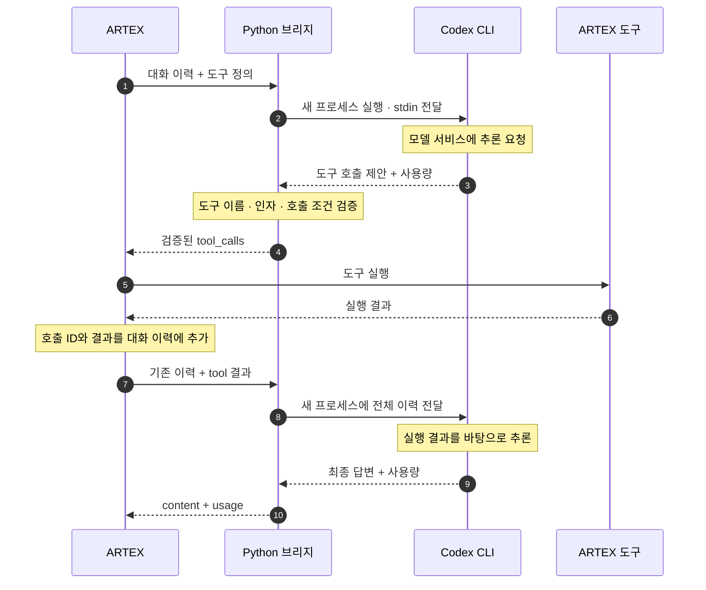

ARTEX로 원큐오더의 보안 테스트를 준비하면서 먼저 고민한 것은 모델 연결 비용이었습니다. 이미 ChatGPT에 100달러 넘게 비용을 지불하고 있는데, ARTEX에 모델을 연결하려고 API 사용료까지 별도로 부담하고 싶지는 않았습니다.

API 키로 OpenAI 모델을 호출하는 비용은 ChatGPT 구독과 별도로 계산됩니다. 반면 ChatGPT 계정으로 로그인한 Codex CLI는 해당 구독에서 제공하는 사용 범위를 활용할 수 있습니다. [OpenAI 공식 과금 안내](https://learn.chatgpt.com/docs/pricing)에서도 구독 사용량과 API 키 기반 과금을 구분하고 있습니다.

그래서 출발점은 **“이미 구독으로 사용하고 있는 Codex를 ARTEX에서도 활용할 수 없을까?”**였습니다. 별도 API 과금 경로를 추가하기보다, ChatGPT 계정으로 로그인된 Codex CLI를 호출하는 방식으로 개발하기로 했습니다. 로컬 Ollama 모델 대신 이 구성을 선택한 이유도 기존 구독을 먼저 활용하고 싶었기 때문입니다.

ARTEX에는 모델 API 주소를 입력하는 설정이 있지만, Codex CLI는 터미널에서 실행하는 프로그램입니다. 주소 하나를 바꾼다고 두 프로그램이 바로 연결되지는 않습니다. 그래서 **ARTEX의 HTTP 요청을 받아 Codex CLI를 실행하고, 결과를 다시 ARTEX가 이해하는 응답으로 돌려주는 Python 브리지**를 만들었습니다.

이 방식도 Codex의 구독 사용 한도를 소모합니다. 한도에 도달하면 사용량이 갱신될 때까지 기다리거나 추가 크레딧 구매 등을 선택해야 합니다. 목표는 무제한으로 모델을 호출하는 것이 아니라, 이미 지불하는 구독의 사용 범위 안에서 개인 실험을 진행하는 것이었습니다.

이 글에서는 요청 변환과 CLI 실행, 도구 호출 검증을 어떻게 구현했는지 설명합니다. 도구 실행 결과가 다음 대화로 이어지는 과정과 인증·사용량 전달을 연결한 방법도 함께 정리했습니다.

## HTTP 요청과 CLI 실행을 연결하는 브리지

ARTEX와 브리지 사이는 HTTP, 브리지와 CLI 사이는 프로세스 입출력으로 연결했습니다. 먼저 각 구간의 역할을 정리하면 다음과 같습니다.

| 구간 | 통신 방식 | 전달하는 내용 |
| --- | --- | --- |
| ARTEX → 브리지 | 로컬 HTTP `POST /v1/chat/completions` | 대화 이력, 도구 정의, 호출 선택 조건 |
| 브리지 → Codex CLI | 자식 프로세스의 표준 입력 `stdin` | 지시문과 대화·도구 정보를 합친 프롬프트 |
| Codex CLI ↔ 모델 서비스 | CLI가 관리하는 외부 연결 | 모델 추론 요청과 응답 |
| Codex CLI → 브리지 | 결과 JSON 파일 + 표준 출력의 JSONL 이벤트 | 최종 답변·도구 호출 제안, 토큰 사용량 |
| 브리지 → ARTEX | HTTP JSON 응답 | `content`, `tool_calls`, `usage` |

브리지가 로컬에서 실행된다는 것은 **추론까지 로컬에서 수행한다는 뜻은 아닙니다**. Codex CLI는 로그인한 계정으로 모델 서비스를 사용합니다. ARTEX가 전달한 대화와 도구 결과도 모델 입력에 포함되므로, 이번 실험에는 제가 통제하는 환경의 더미 데이터만 사용했습니다.

역할은 **Codex CLI가 다음 답변이나 도구 호출을 제안하고, ARTEX가 도구를 실행하는 것**으로 나눴습니다. 이를 위해 CLI의 자체 셸 도구를 끄고, 브리지는 호출 내용을 검증해 전달하도록 구현했습니다.

## 왜 ARTEX 내부가 아니라 별도 브리지를 만들었을까요?

ARTEX에는 이미 모델을 호출하고, 반환된 도구 호출을 실행하고, 그 결과를 대화에 추가하는 흐름이 있습니다. 여기에 Codex 전용 실행 코드를 넣기보다는 기존 모델 연결 지점을 활용했습니다.

브리지가 제공하는 인터페이스는 두 개입니다.

```text
GET  /v1/models
POST /v1/chat/completions
```

ARTEX에서는 기존 `OpenAI` provider를 선택하고 Base URL을 브리지로 바꿉니다. 이 설정 이름은 **ARTEX와 브리지 사이의 요청·응답 형식**을 선택하는 것입니다. 브리지가 OpenAI API 키를 받아 API 서버로 그대로 전달하는 프록시는 아닙니다. 브리지 뒤에서는 `codex exec`라는 로컬 프로세스가 실행됩니다.

구현 파일도 작게 분리했습니다.

```text
tools/codex_bridge/
├── bridge.py        # HTTP 처리, CLI 실행, 응답 변환
├── test_bridge.py   # 변환·인증·프로세스·사용량 테스트
├── requirements.txt
└── README.md        # 설치와 ARTEX 설정
```

기존 ARTEX 서버·DB·프런트엔드 코드를 변경하지 않고 연결 방식을 추가할 수 있다는 점이 이 구성의 장점입니다. 반대로 모델 호출 때마다 CLI를 시작하는 비용과, 두 인터페이스를 맞춰 유지해야 하는 부담은 브리지가 담당합니다.

## 1. 대화와 도구 정의를 CLI 입력으로 바꿉니다

첫 단계는 `prepare()`입니다. 요청의 모델 별칭이 `codex-cli`인지 확인하고, 메시지와 도구 정의를 검사합니다. 이미지·오디오 입력이 아니라 텍스트 메시지와 function 도구를 받도록 범위를 제한했습니다.

대화의 마지막 질문만 전달하면 도구를 사용하는 작업이 이어지지 않습니다. 앞서 어떤 도구를 호출했고 어떤 결과를 받았는지 알아야 하기 때문입니다. 그래서 다음 필드를 함께 보존합니다.

```python
# bridge.py의 prepare() 발췌
envelope = {key: body[key] for key in (
    "messages", "tools", "tool_choice", "parallel_tool_calls"
) if key in body}
```

이 JSON 앞에는 브리지의 지시문을 붙입니다. 핵심은 “주어진 대화의 다음 assistant 응답을 만들고, 필요한 도구는 직접 실행하지 말고 호출 제안으로 반환하라”입니다. 도구 결과를 더 높은 우선순위의 지시로 취급하지 말라는 내용도 포함했습니다.

`messages` 안의 `assistant.tool_calls`와 `tool.tool_call_id`도 그대로 전달합니다. 도구 결과가 어떤 호출에 대한 것인지 연결하는 식별자이므로, 단순한 대화 문자열로 줄이면서 버리면 안 됩니다.

대화를 유지하는 방식은 Codex의 최근 세션을 재개하는 것이 아닙니다. **ARTEX가 대화 이력을 관리하고, 브리지는 매 요청에 그 이력을 넣어 새 CLI 실행을 시작합니다.** 따라서 다른 ARTEX 작업이 `resume --last`를 통해 엉뚱한 세션에 합쳐지는 방식도 사용하지 않습니다.

## 2. `codex exec`와는 HTTP가 아니라 프로세스로 통신합니다

브리지와 CLI 사이에 별도의 Codex HTTP 서버를 띄우지는 않았습니다. Python의 `subprocess.Popen()`으로 CLI를 실행하고, `stdin`에 프롬프트를 넣습니다.

아래는 실제 실행 옵션의 핵심을 추린 것입니다. `schema.json`과 `answer.json`은 요청마다 생성하는 임시 디렉터리 안의 파일입니다.

```bash
codex exec \
  --json \
  --ignore-user-config \
  --ephemeral \
  --skip-git-repo-check \
  --sandbox read-only \
  -c 'approval_policy="never"' \
  -c 'forced_login_method="chatgpt"' \
  -c 'features.shell_tool=false' \
  -c 'web_search="disabled"' \
  --output-schema schema.json \
  --output-last-message answer.json \
  -
```

마지막 `-`는 프롬프트를 표준 입력으로 받게 합니다. 사용자 입력을 셸 명령 문자열에 끼워 넣는 대신, 실행 인자 배열과 입력 데이터를 분리했습니다.

```python
# CodexRunner.__call__()의 프로세스 통신 부분 발췌
with tempfile.TemporaryFile() as events, subprocess.Popen(
    args,
    stdin=subprocess.PIPE,
    stdout=events,
    stderr=subprocess.DEVNULL,
    cwd=root,
    env=env,
    start_new_session=(os.name == "posix"),
) as proc:
    proc.communicate(prompt.encode("utf-8"), timeout=self.timeout)
```

CLI에서 받는 결과는 두 갈래입니다.

첫째, `--output-last-message`로 저장한 최종 메시지를 읽습니다. `--output-schema`에는 `content`와 `tool_calls`를 가진 JSON 구조를 지정했습니다. 자연어 답변 전체를 정규식으로 훑어 명령어를 찾아내는 방식이 아닙니다.

둘째, `--json`으로 표준 출력에 기록된 JSONL 이벤트에서 사용량을 읽습니다. 최종 답변과 실행 메타데이터의 출처를 분리한 것입니다. 비대화형 실행과 JSONL 이벤트 출력은 [Codex 공식 CLI 문서](https://learn.chatgpt.com/docs/developer-commands#codex-exec)에서도 설명하고 있습니다.

임시 작업 디렉터리를 사용하고 개인 설정 로딩을 끈 이유는, 원래 작업하던 프로젝트의 지시문이나 개인 MCP 설정이 모델 연결에 섞이지 않게 하기 위해서입니다. 인증은 CLI가 관리합니다. 브리지가 인증 파일을 읽어서 토큰을 추출하거나 복사하지 않습니다.

## 3. 도구 호출은 어떻게 한 바퀴를 돌까요?



위 다이어그램은 도구를 한 번 실행한 뒤 최종 답변을 만드는 경우입니다. 추가 조회가 필요하면 도구 호출과 결과 전달 구간이 다시 반복됩니다.

예를 들어 ARTEX가 `lookup`이라는 조회 도구를 제공한다고 가정해 보겠습니다. 아래 JSON은 통신 구조를 설명하기 위한 축약 예시이며, 원큐오더의 실제 요청 로그가 아닙니다.

모델이 조회가 필요하다고 판단하면 CLI의 최종 결과는 다음 형태가 됩니다.

```json
{
  "content": "",
  "tool_calls": [
    {
      "name": "lookup",
      "arguments": "{\"id\":7}"
    }
  ]
}
```

이 시점에는 조회가 실행되지 않았습니다. 브리지의 `decode_answer()`가 결과를 검사한 뒤 ARTEX가 사용하는 도구 호출 형식으로 바꿉니다. 호출 ID도 이 단계에서 생성합니다.

```json
{
  "role": "assistant",
  "content": null,
  "tool_calls": [
    {
      "id": "call_example_01",
      "type": "function",
      "function": {
        "name": "lookup",
        "arguments": "{\"id\":7}"
      }
    }
  ]
}
```

ARTEX는 이 응답을 받아 자신의 도구 실행 흐름으로 넘깁니다. 실행 결과가 `found`였다면 다음 모델 요청에는 이전 assistant 메시지와 함께 아래 메시지를 넣습니다.

```json
{
  "role": "tool",
  "tool_call_id": "call_example_01",
  "content": "found"
}
```

브리지는 이 이력을 다시 CLI로 전달합니다. 모델은 이제 실제 도구 결과를 보고 최종 답변을 작성하거나, 추가 도구 호출을 제안할 수 있습니다.

### 도구 이름과 인자를 검증했습니다

출력 스키마는 응답의 외형을 정해 줍니다. 하지만 도구 이름과 인자까지 올바르다는 보장은 별도의 검사로 보완해야 합니다.

`decode_answer()`에서는 등록된 도구 이름인지, `arguments`가 JSON 객체인지, 해당 도구의 JSON Schema를 만족하는지 확인합니다. `tool_choice=none`인데 호출을 반환하거나, `required`인데 호출이 없거나, 병렬 호출을 금지했는데 여러 호출을 반환하는 경우도 거절합니다.

이 검사를 통과하지 못하면 `502`를 반환하며, 잘못된 호출을 ARTEX에 전달하지 않습니다. 입력 스키마의 외부 참조도 막아, 도구 스키마를 검사하는 과정에서 외부 URL을 가져오지 않게 했습니다.

다만 **스키마 검증은 작업의 안전성을 판정하는 기능은 아닙니다**. 올바른 문자열 형식의 명령도 실행하면 위험할 수 있습니다. 대상 제한과 실행 권한, 승인 정책은 ARTEX와 테스트 환경에서 따로 관리해야 합니다. CLI의 `read-only` 옵션 역시 ARTEX가 실행하는 도구까지 읽기 전용으로 만드는 설정은 아닙니다.

## 4. 브리지 접속과 CLI 로그인을 분리했습니다

이 연결에는 서로 다른 인증이 있습니다.

| 구간 | 인증 값 | 관리 주체 |
| --- | --- | --- |
| ARTEX → 로컬 브리지 | `ARTEX_CODEX_BRIDGE_TOKEN`을 Bearer 토큰으로 전달 | 브리지 운영자와 ARTEX 설정 |
| Codex CLI → 모델 서비스 | `codex login`으로 설정한 로그인 | Codex CLI |

ARTEX의 API Key 칸에는 첫 번째 토큰을 넣습니다. 이것은 브리지에 접근하기 위한 로컬 비밀번호이지, OpenAI 계정의 인증 정보를 복사해 넣는 자리가 아닙니다.

자식 프로세스 환경에서는 `OPENAI_API_KEY`, `CODEX_API_KEY`, `ARTEX_CODEX_BRIDGE_TOKEN`을 제거합니다. ARTEX의 설정 때문에 들어온 로컬 토큰이 CLI의 API 키로 오인되거나 자식 프로세스에 불필요하게 전달되는 일을 피하기 위한 처리입니다.

서버는 `127.0.0.1`에만 바인딩하며, 토큰을 비교하고 `Origin` 헤더가 있는 요청을 거절합니다. 브라우저에서 직접 호출하는 서비스가 아니라 ARTEX 백엔드가 호출하는 로컬 연결 서버로 범위를 정했습니다. 프롬프트·도구 결과·CLI 오류 원문을 HTTP 오류나 기본 접속 로그에 출력하지 않도록 했습니다.

## 5. CLI 토큰 사용량을 ARTEX 응답에 연결했습니다

ARTEX에서 작업별 모델 사용량을 확인할 수 있도록, 답변과 함께 토큰 집계도 전달하는 기능을 구현했습니다. 사용량의 출처는 모델이 생성한 답변이 아니라 CLI가 출력하는 `turn.completed.usage` 이벤트로 정했습니다.

`read_usage()`는 JSONL 이벤트에서 입력·출력·캐시 토큰 값을 읽고, 음수나 잘못된 자료형이 없는지 검사합니다. 이후 ARTEX가 읽는 응답의 `usage` 필드로 변환합니다.

| CLI 이벤트 필드 | ARTEX에 반환하는 필드 |
| --- | --- |
| `input_tokens` | `usage.prompt_tokens` |
| `output_tokens` | `usage.completion_tokens` |
| 입력 + 출력 | `usage.total_tokens` |
| `cached_input_tokens` | `usage.prompt_tokens_details.cached_tokens` |
| 제공된 `reasoning_output_tokens` | `usage.completion_tokens_details.reasoning_tokens` |

합계는 입력 토큰과 출력 토큰을 더해 계산하도록 구현했습니다. 캐시 입력은 입력의 일부이고 추론 토큰은 출력의 일부이므로, 별도 상세 필드에 담되 총합에는 다시 더하지 않습니다.

사용량 이벤트가 없으면 `usage`를 생략하도록 처리했습니다. 측정값을 받지 못한 요청을 사용량 `0`으로 기록하지 않기 위해서입니다. 일반 JSON 응답에는 `usage`를 함께 넣고, SSE 요청에서는 `include_usage=true`일 때 종료 직전에 사용량 전용 이벤트를 보내도록 연결했습니다.

검증에는 여러 턴의 합산, 캐시 토큰의 중복 합산 방지, 사용량 누락, JSON·SSE 응답 전달을 포함했습니다. 이렇게 전달한 값으로 ARTEX가 호출 사용량을 집계할 수 있습니다. 구독의 잔여 한도나 청구 금액을 계산하는 기능은 아닙니다.

## 직접 연결할 때의 실행 순서

현재 브리지 코드가 있는 브랜치에서 시작합니다. 기존 변경 사항이 있다면 먼저 보존하고 전환해야 합니다.

```bash
git fetch origin
git switch feat/codex-cli-bridge

codex login
codex login status
codex exec --help

python3 -m venv tools/codex_bridge/.venv
tools/codex_bridge/.venv/bin/python -m pip install \
  -r tools/codex_bridge/requirements.txt
```

CLI 도움말에서 앞서 사용한 실행 옵션을 지원하는지 확인합니다. 다음으로 로컬 접속용 토큰을 만들고 브리지를 시작합니다.

```bash
export ARTEX_CODEX_BRIDGE_TOKEN="$(python3 -c 'import secrets; print(secrets.token_urlsafe(32))')"

tools/codex_bridge/.venv/bin/python \
  tools/codex_bridge/bridge.py --effort low
```

토큰은 비밀번호 저장소 등에 따로 보관하고 ARTEX 설정에도 같은 값을 입력합니다. 저장소나 블로그에는 넣지 않습니다. 새 터미널에서 다시 생성하면 다른 토큰이므로, 실행 중인 서버와 다른 값을 사용하지 않도록 주의해야 합니다.

ARTEX의 LLM 프로필은 다음과 같이 설정합니다.

| 항목 | 설정 |
| --- | --- |
| Provider | `OpenAI` |
| Base URL | `http://127.0.0.1:8766/v1` |
| API Key | 브리지와 같은 로컬 토큰 |
| Model | `codex-cli` |
| 스트리밍 | 끔 |

`codex-cli`는 이 브리지가 받는 별칭입니다. 실제 모델을 고르려면 서버 시작 옵션 `--model`에 계정에서 사용할 수 있는 모델 ID를 지정합니다. ARTEX의 Model 칸에 임의의 실제 모델명을 넣는 방식은 아닙니다.

토큰 환경변수를 동일하게 준비한 다른 터미널에서 다음 요청으로 연결을 확인할 수 있습니다.

```bash
curl --max-time 250 http://127.0.0.1:8766/v1/chat/completions \
  -H "Authorization: Bearer $ARTEX_CODEX_BRIDGE_TOKEN" \
  -H 'Content-Type: application/json' \
  -d '{
    "model": "codex-cli",
    "messages": [{"role": "user", "content": "Reply with OK."}],
    "stream": false
  }'
```

확인할 값은 `choices[0].message.content`와 `usage`입니다. 그다음 ARTEX에서 일반 대화, 무해한 도구 호출, 도구 결과를 읽은 후속 응답 순서로 확인합니다. 단순 대화만 성공한 것과 도구 왕복까지 연결된 것은 구분해서 봐야 합니다.

이 주소는 ARTEX 백엔드와 브리지가 같은 호스트에서 실행되는 구성을 전제로 합니다. Docker 컨테이너 안의 `127.0.0.1`은 호스트가 아니며, 현재 브리지가 루프백에만 바인딩하므로 `host.docker.internal`만 바꿔 넣는 것으로 해결되지 않습니다. Windows에서는 WSL 안에 CLI·브리지·ARTEX 백엔드를 함께 두는 구성을 안내했습니다.

## 실행 중 막히는 지점과 처리 방식

동시 CLI 호출은 하나로 제한했습니다. `BoundedSemaphore(1)`을 획득하지 못한 요청에는 기다리는 큐를 늘리는 대신 `429`를 반환합니다. 따라서 첫 실행은 ARTEX 작업 하나로 확인하는 편이 좋습니다. Worker 수를 줄여도 별도 대화나 요약 요청이 겹치면 제한에 걸릴 수 있습니다.

요청별 CLI 제한 시간은 기본 `240초`입니다. POSIX 환경에서 시간을 넘기면 프로세스 그룹을 종료하고 `504`를 반환합니다. 반면 HTTP 클라이언트가 먼저 연결을 끊었다고 CLI가 즉시 취소되는 구현은 아닙니다. 완료되거나 서버 타임아웃에 도달할 때까지 실행될 수 있습니다.

| 증상 | 먼저 확인할 항목 |
| --- | --- |
| `401` | ARTEX와 브리지의 토큰이 같은지 |
| `400` | 모델 별칭과 입력 형식, 미지원 옵션 |
| `429` | 다른 작업이나 대화가 실행 중인지 |
| `502` | CLI 로그인·버전·모델 접근·사용 한도, 구조화 응답 검증 |
| `503` | 서버가 사용하는 환경에서 CLI 실행 파일을 찾을 수 있는지 |
| `504` | 대화 길이·추론 강도·서버 타임아웃 |

스트리밍을 끈 이유도 구현과 관련이 있습니다. 현재 SSE는 CLI 결과가 완성된 뒤 응답을 프레임으로 포장하는 호환 기능입니다. 모델이 생성하는 토큰을 실시간으로 중계하는 방식이 아닙니다. 스트리밍을 켠다고 첫 글자가 빨리 나타나지는 않습니다.

또한 `max_tokens` 같은 일부 요청 필드는 호환을 위해 받지만 CLI에 매핑하지 않습니다. ARTEX의 출력 토큰 설정을 바꿨다고 이 브리지가 그 상한을 강제하는 것은 아닙니다. 지원 범위를 넓게 보이게 하기보다 실제로 연결한 기능을 기준으로 사용해야 합니다.

## 무엇을 확인했는가

글을 작성하면서 다음 명령을 다시 실행했고, 브리지 단위 테스트 **22개가 모두 통과**했습니다.

```bash
tools/codex_bridge/.venv/bin/python \
  -m unittest discover -s tools/codex_bridge -v
```

테스트는 가짜 CLI와 로컬 HTTP 서버로 수행합니다. 대화·도구 호출 ID 보존, 잘못된 도구와 인자 거절, 인증 실패 시 CLI 미호출, 동시성 제한, 타임아웃, 임시 파일 정리, JSON/SSE 사용량 전달을 확인합니다. 실제 계정의 모델 품질이나 지연 시간을 측정하는 테스트는 아닙니다.

실제 ARTEX 작업에서의 사용 과정은 [원큐오더 주문 조회 권한 점검 글](/posts/artex-wonq-order-access/)에 별도로 기록했습니다. 그 작업에서는 이 브리지 구성을 사용해 ARTEX가 테스트 도구를 실행하고 결과를 분석했습니다. 실행 화면과 대상 API의 응답 증거는 해당 글에서 확인할 수 있습니다.

이미 지불하고 있는 ChatGPT 구독을 ARTEX 실험에도 활용하고 싶다는 생각에서 시작한 개발이었습니다. 이를 실제로 연결하려면 CLI 실행뿐 아니라 **대화와 호출 ID 유지, 도구 호출 검증, 실행 결과의 재전달**까지 구현해야 했습니다. 이 연결을 브리지로 분리하면서, 모델 호출은 로그인된 Codex CLI에 맡기고 작업 실행과 기록은 ARTEX에 그대로 남겼습니다.

구현을 직접 보려면 아래 파일을 참고하면 됩니다.

- [브리지 구현 — bridge.py](https://github.com/namsh1125/ARTEX/blob/5fb8910be4ab497535602ab705f9c73933efb8b8/tools/codex_bridge/bridge.py)
- [22개 테스트 — test_bridge.py](https://github.com/namsh1125/ARTEX/blob/5fb8910be4ab497535602ab705f9c73933efb8b8/tools/codex_bridge/test_bridge.py)
- [설치·지원 범위 — README](https://github.com/namsh1125/ARTEX/blob/5fb8910be4ab497535602ab705f9c73933efb8b8/tools/codex_bridge/README.md)
