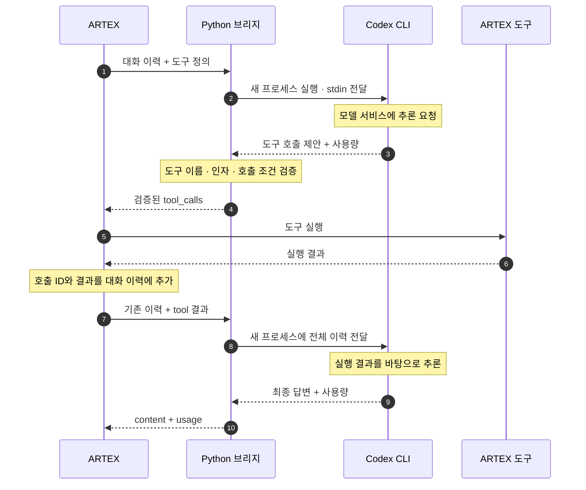

ARTEX로 원큐오더의 보안 테스트를 준비하면서 가장 먼저 고민한 것은 모델 연결 비용이었습니다. 이미 ChatGPT에 100달러 넘게 지불하고 있는데, 모델을 연결하려고 API 사용료까지 따로 내고 싶지는 않았습니다. [OpenAI 공식 과금 안내](https://learn.chatgpt.com/docs/pricing)에서도 구독 사용량과 API 키 기반 과금을 구분합니다.

그래서 **ChatGPT 계정으로 로그인된 Codex CLI를 ARTEX에서 호출하는 방식**을 택했습니다. 로컬 Ollama 모델 대신 이 구성을 고른 이유도 기존 구독을 먼저 활용하고 싶었기 때문입니다. 이 방식도 구독 사용 한도를 소모하므로, 무제한 호출이 아니라 이미 내는 비용의 범위 안에서 개인 실험을 하는 것이 목표입니다.

문제는 ARTEX는 모델 API에 HTTP 요청을 보내지만, Codex CLI는 터미널에서 실행하는 프로그램이라는 점입니다. 두 프로그램 사이에서 요청과 응답을 연결할 방법이 필요했습니다.

## 왜 별도 브리지로 분리했는가

ARTEX에는 모델 호출, 도구 실행, 실행 결과를 대화에 추가하는 흐름이 이미 있습니다. 이 흐름을 수정하지 않고 연결 방식을 추가하기 위해 **모델 요청을 받아 `codex exec`를 실행하고, 결과를 ARTEX의 응답 형식으로 변환하는 Python 브리지**를 만들었습니다.

ARTEX에서는 모델 연결 설정만 바꾸고, CLI 실행 옵션과 응답 변환은 브리지에서 관리하도록 역할을 나눴습니다. 대신 별도 서버를 운영해야 하며, 요청마다 CLI 프로세스를 새로 시작하는 데 따른 지연과 자원 소모가 생깁니다.

## 요청이 처리되는 흐름

도구 조회가 한 번 필요한 작업을 기준으로 보면 다음과 같습니다.



ARTEX는 로컬 HTTP(`POST /v1/chat/completions`)로 브리지에 요청합니다. 브리지와 CLI 사이의 입력·출력 처리부터, 도구 결과를 다음 요청으로 이어주는 과정까지 순서대로 구현했습니다.

## 1. 대화와 도구 정의를 CLI 입력으로 변환

도구를 사용하는 작업에서는 마지막 질문만 전달해서는 다음 행동을 결정할 수 없습니다. 앞서 어떤 도구를 호출했고 어떤 결과를 받았는지도 필요합니다. 그래서 `prepare()`에서 대화 이력과 사용 가능한 도구 정의, 호출 조건을 함께 묶어 CLI 입력으로 만들었습니다.

```python
# bridge.py의 prepare() 발췌
envelope = {key: body[key] for key in (
    "messages", "tools", "tool_choice", "parallel_tool_calls"
) if key in body}
```

이 JSON 앞에는 "다음 assistant 응답을 만들고, 도구는 직접 실행하지 말고 호출 제안으로 반환하라"는 지시문을 붙였습니다. 도구 결과는 지시가 아닌 데이터로 취급하도록 했으며, 이전 호출의 ID와 결과 메시지의 `tool_call_id`도 보존했습니다.

대화 이력의 관리 주체는 ARTEX로 두었습니다. 브리지는 별도 세션을 이어가는 대신 매 요청에 전달된 이력으로 동작합니다. 입력은 텍스트 메시지와 function 도구로 제한하고, 지원하지 않는 형식은 이 단계에서 거절합니다.

## 2. `codex exec`와는 프로세스로 통신

입력을 준비한 다음에는 CLI를 실행하고, 프로그램에서 다시 읽을 수 있는 형태로 답변을 받아야 했습니다. 실행 설정에서는 세 가지에 집중했습니다.

- `forced_login_method="chatgpt"`로 로그인된 ChatGPT 계정을 사용합니다.
- `--output-schema`로 답변과 도구 호출을 담을 JSON 구조를 지정합니다.
- `features.shell_tool=false`로 CLI 자체의 셸 도구를 끕니다. 명령 실행은 ARTEX에 맡기기 위한 설정입니다.

이를 반영한 실행 옵션은 다음과 같습니다. 파일 경로는 요청별 임시 디렉터리에 생성하는 파일을 간략히 표기했습니다.

```bash
codex exec \
  --json \
  --ignore-user-config \
  --ephemeral \
  --skip-git-repo-check \
  --sandbox read-only \
  -c 'approval_policy="never"' \
  -c 'forced_login_method="chatgpt"' \
  -c 'features.shell_tool=false' \
  -c 'web_search="disabled"' \
  --output-schema schema.json \
  --output-last-message answer.json \
  -
```

Python에서는 `subprocess.Popen()`으로 프로세스를 시작하고 프롬프트를 `stdin`에 전달했습니다. 명령의 마지막 `-`가 이 입력 방식을 지정합니다. 사용자 입력을 셸 명령 문자열에 끼워 넣지 않고 실행 인자와 분리했습니다.

```python
# CodexRunner.__call__()의 프로세스 통신 부분 발췌
with tempfile.TemporaryFile() as events, subprocess.Popen(
    args,
    stdin=subprocess.PIPE,
    stdout=events,
    stderr=subprocess.DEVNULL,
    cwd=root,
    env=env,
    start_new_session=(os.name == "posix"),
) as proc:
    proc.communicate(prompt.encode("utf-8"), timeout=self.timeout)
```

결과는 두 갈래로 받습니다.

- `--output-last-message`가 저장한 JSON 파일에서 `content`와 `tool_calls`를 읽습니다.
- `--json`으로 표준 출력에 기록된 JSONL 이벤트. 여기서 토큰 사용량을 읽습니다.

임시 작업 디렉터리를 쓰고 개인 설정 로딩을 끈 것은, 기존 프로젝트의 지시문이나 개인 MCP 설정이 모델 연결에 섞이지 않게 하기 위해서입니다. 비대화형 실행과 JSONL 출력은 [Codex 공식 CLI 문서](https://learn.chatgpt.com/docs/developer-commands#codex-exec)에 설명되어 있습니다.

## 3. 도구 호출을 변환하고 실행 결과를 다시 전달

CLI에서 받은 JSON을 ARTEX에 그대로 넘길 수는 없습니다. ARTEX가 도구를 실행하고 나중에 그 결과를 연결할 수 있도록 호출 형식을 맞춰야 합니다. 아래는 ID로 테스트 항목을 찾는 가상의 `lookup` 도구를 사용한 설명용 예시입니다.

모델이 ID `7`을 조회하기로 했다면 다음과 같은 호출 제안을 반환합니다.

```json
{
  "content": "",
  "tool_calls": [
    { "name": "lookup", "arguments": "{\"id\":7}" }
  ]
}
```

이 시점에는 조회가 실행되지 않았습니다. 브리지의 `decode_answer()`가 도구 이름과 인자를 검사하고, 호출 ID를 생성해 ARTEX 형식으로 변환합니다.

```json
{
  "role": "assistant",
  "content": null,
  "tool_calls": [
    {
      "id": "call_example_01",
      "type": "function",
      "function": { "name": "lookup", "arguments": "{\"id\":7}" }
    }
  ]
}
```

ARTEX가 도구를 실행하면 다음 요청에는 이전 assistant 메시지와 함께 아래 메시지가 들어가고, 브리지는 이 이력을 다시 CLI로 전달합니다.

```json
{
  "role": "tool",
  "tool_call_id": "call_example_01",
  "content": "found"
}
```

이 결과를 받은 모델은 추가 조회를 제안하거나 답변을 마무리합니다. 조회를 끝냈다면 CLI의 결과는 다음처럼 `tool_calls`가 빈 응답이 됩니다.

```json
{
  "content": "ID 7에 해당하는 테스트 항목을 찾았습니다.",
  "tool_calls": []
}
```

브리지는 이를 일반 assistant 메시지로 반환합니다. 추가 도구가 필요할 때만 호출과 결과 전달 구간을 반복하므로, 조회 결과를 읽고 답변하는 단계까지 하나의 작업으로 이어집니다.

### 도구 이름과 인자 검증

출력 스키마는 응답의 외형만 정해 줍니다. 그래서 `decode_answer()`에서 다음을 추가로 확인합니다.

- 등록된 도구 이름인지
- `arguments`가 JSON 객체이고 해당 도구의 JSON Schema를 만족하는지
- `tool_choice=none`인데 호출이 있거나, `required`인데 호출이 없는 경우
- 병렬 호출을 금지했는데 여러 호출이 온 경우

통과하지 못하면 `502`를 반환하고 ARTEX에는 전달하지 않습니다. 입력 스키마의 외부 참조도 막아, 검사 중 외부 URL을 가져오지 않게 했습니다.

다만 스키마 검증이 작업의 안전성을 판정하지는 않습니다. 대상 제한, 실행 권한, 승인 정책은 ARTEX와 테스트 환경에서 따로 관리해야 합니다. CLI의 `read-only` 옵션도 ARTEX가 실행하는 도구까지 읽기 전용으로 만들지는 않습니다.

## 4. 인증 분리

요청을 처리하는 흐름을 연결한 뒤에는, 로컬 브리지에 접근하는 인증과 모델 서비스를 사용하는 로그인을 구분했습니다. 브리지는 자체 접속 토큰만 확인하고, 계정 로그인은 CLI가 관리하도록 했습니다.

| 구간 | 인증 값 | 관리 주체 |
| --- | --- | --- |
| ARTEX → 로컬 브리지 | `ARTEX_CODEX_BRIDGE_TOKEN` (Bearer) | 브리지 운영자와 ARTEX 설정 |
| Codex CLI → 모델 서비스 | `codex login` | Codex CLI |

ARTEX의 API Key 칸에는 브리지 접속용 토큰을 넣습니다. 브리지는 CLI의 인증 파일을 읽거나 복사하지 않습니다.

- 자식 프로세스 환경에서 `OPENAI_API_KEY`, `CODEX_API_KEY`, `ARTEX_CODEX_BRIDGE_TOKEN`을 제거해 로컬 토큰이 API 키로 오인되는 것을 막았습니다.
- 서버는 `127.0.0.1`에만 바인딩하고, 토큰을 비교하며, `Origin` 헤더가 있는 요청은 거절합니다.
- 프롬프트·도구 결과·CLI 오류 원문은 HTTP 오류나 접속 로그에 출력하지 않습니다.

## 5. 토큰 사용량 전달

ARTEX에서 작업별 사용량을 볼 수 있도록 응답에 토큰 집계를 함께 담았습니다. 사용량의 출처는 모델의 답변이 아니라 CLI가 출력하는 `turn.completed.usage` 이벤트입니다. `read_usage()`가 값을 읽고 음수나 잘못된 자료형을 검사한 뒤 `usage` 필드로 변환합니다.

| CLI 이벤트 필드 | ARTEX에 반환하는 필드 |
| --- | --- |
| `input_tokens` | `usage.prompt_tokens` |
| `output_tokens` | `usage.completion_tokens` |
| 입력 + 출력 | `usage.total_tokens` |
| `cached_input_tokens` | `usage.prompt_tokens_details.cached_tokens` |
| `reasoning_output_tokens` | `usage.completion_tokens_details.reasoning_tokens` |

캐시 입력은 입력의, 추론 토큰은 출력의 일부이므로 상세 필드에만 담고 총합에는 다시 더하지 않습니다. 사용량 이벤트가 없으면 `0`으로 기록하지 않고 `usage`를 생략합니다. SSE 요청에서는 `include_usage=true`일 때 종료 직전에 사용량 이벤트를 보냅니다. 이 값은 호출 사용량 집계용이며, 구독의 잔여 한도나 청구 금액을 계산하지는 않습니다.

## 연결해서 확인하기

설치·실행 순서는 아래에 접어두었습니다. 본문에서 설명한 브리지를 실행한 뒤 ARTEX의 모델 프로필을 연결하는 과정입니다.

<details>
<summary>설치와 ARTEX 설정 펼치기</summary>

```bash
git fetch origin
git switch feat/codex-cli-bridge

codex login
codex login status
codex exec --help   # 위 실행 옵션 지원 여부 확인

python3 -m venv tools/codex_bridge/.venv
tools/codex_bridge/.venv/bin/python -m pip install \
  -r tools/codex_bridge/requirements.txt

export ARTEX_CODEX_BRIDGE_TOKEN="$(python3 -c 'import secrets; print(secrets.token_urlsafe(32))')"

tools/codex_bridge/.venv/bin/python \
  tools/codex_bridge/bridge.py --effort low
```

토큰은 따로 보관하고 ARTEX 설정에도 같은 값을 입력합니다. 새 터미널에서 다시 생성하면 다른 값이 되니 주의해야 합니다.

| 항목 | 설정 |
| --- | --- |
| Provider | `OpenAI` |
| Base URL | `http://127.0.0.1:8766/v1` |
| API Key | 브리지와 같은 로컬 토큰 |
| Model | `codex-cli` |
| 스트리밍 | 끔 |

`codex-cli`는 브리지가 받는 별칭입니다. 실제 모델을 지정하려면 서버 시작 옵션 `--model`에 계정에서 사용 가능한 모델 ID를 넣습니다. 연결은 아래 요청으로 확인하며, `choices[0].message.content`와 `usage`를 보면 됩니다.

```bash
curl --max-time 250 http://127.0.0.1:8766/v1/chat/completions \
  -H "Authorization: Bearer $ARTEX_CODEX_BRIDGE_TOKEN" \
  -H 'Content-Type: application/json' \
  -d '{
    "model": "codex-cli",
    "messages": [{"role": "user", "content": "Reply with OK."}],
    "stream": false
  }'
```

이 설정은 ARTEX 백엔드와 브리지를 같은 호스트에서 실행하는 구성을 기준으로 합니다. 기본 Docker bridge 네트워크에서는 컨테이너의 `127.0.0.1`이 호스트를 가리키지 않으므로 그대로 적용할 수 없습니다. Windows 실행은 CLI·브리지·ARTEX 백엔드를 WSL 안에 함께 두는 구성을 안내했습니다.

</details>

브리지 검증에는 가짜 CLI 프로세스와 로컬 HTTP 서버를 사용했습니다. 다음 명령으로 실행한 테스트 22개가 통과했으며, 대화·호출 ID 보존, 잘못된 도구 인자 거절, 인증, 타임아웃, 사용량 변환을 확인했습니다.

```bash
tools/codex_bridge/.venv/bin/python \
  -m unittest discover -s tools/codex_bridge -v
```

실제 연결은 [ARTEX로 원큐오더의 주문 조회 권한을 점검한 작업](/posts/artex-wonq-order-access/)에서 사용했습니다. 해당 글에는 도구 실행과 API 응답을 확인한 화면을 남겼습니다. 단위 테스트의 변환 검증과 실제 작업의 실행 기록을 구분해 확인할 수 있습니다.

## 제약 사항

- **동시 실행 1개**: `BoundedSemaphore(1)`을 얻지 못한 요청은 대기시키지 않고 `429`를 반환합니다.
- **타임아웃**: 기본 `240초`이며, 초과하면 프로세스 그룹을 종료하고 `504`를 반환합니다. 클라이언트가 먼저 연결을 끊어도 CLI가 즉시 취소되지는 않습니다.
- **실시간 스트리밍 미지원**: SSE는 CLI 결과가 완성된 뒤 프레임으로 포장하는 호환 기능이라, 켜도 첫 글자가 빨리 나오지 않습니다.
- **일부 필드 미매핑**: `max_tokens` 같은 필드는 받기만 하고 CLI에 전달하지 않으므로 출력 상한이 강제되지 않습니다.

오류 코드별 확인 항목은 아래 README에 정리했습니다.

## 마무리

이번 구현으로 ARTEX의 작업 실행 흐름은 유지하면서, 모델 요청을 로그인된 Codex CLI로 처리할 수 있게 됐습니다. 구독 활용이라는 목적을 실제 연결로 만들려면 CLI 실행뿐 아니라 대화 이력, 도구 호출 형식, 인증과 사용량 전달까지 맞춰야 했습니다.

별도 API 과금 경로를 추가하지 않는 구성은 마련했지만, API 방식과 비용·속도를 비교 측정한 것은 아닙니다. 개인 실험에 필요한 연결을 구현하고 실제 ARTEX 작업에 적용한 것이 이번 개발의 결과입니다.

## 참고

- [브리지 구현 — bridge.py](https://github.com/namsh1125/ARTEX/blob/5fb8910be4ab497535602ab705f9c73933efb8b8/tools/codex_bridge/bridge.py)
- [설치·지원 범위 — README](https://github.com/namsh1125/ARTEX/blob/5fb8910be4ab497535602ab705f9c73933efb8b8/tools/codex_bridge/README.md)
